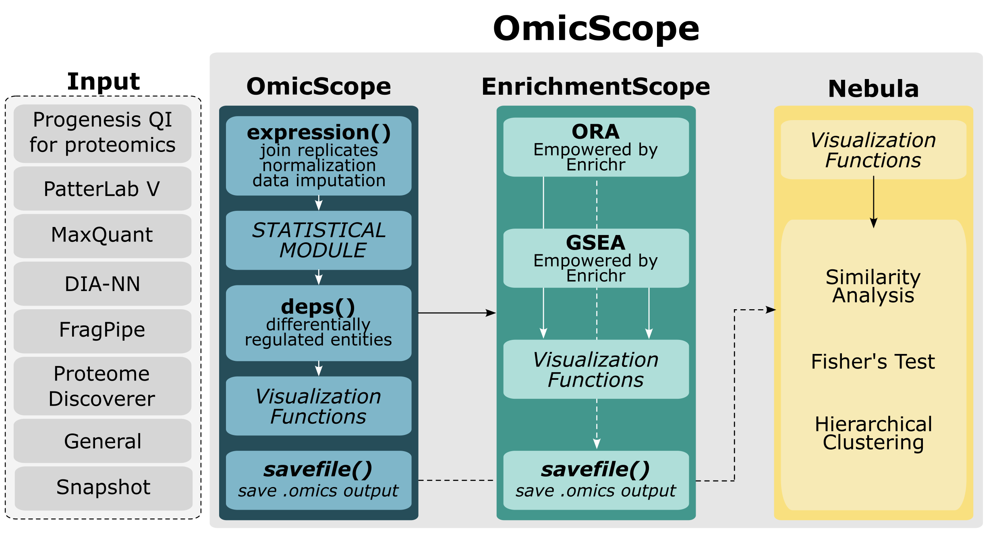

========
Overview
========

.. image:: https://readthedocs.org/projects/omicscope/badge/?style=flat
    :target: https://omicscope.readthedocs.io/
    :alt: Documentation Status

.. image:: https://img.shields.io/pypi/v/omicscope.svg
    :alt: PyPI Package latest release
    :target: https://pypi.org/project/omicscope

.. image:: https://img.shields.io/pypi/wheel/omicscope.svg
    :alt: PyPI Wheel
    :target: https://pypi.org/project/omicscope

.. image:: https://img.shields.io/pypi/pyversions/omicscope.svg
    :alt: Supported versions
    :target: https://pypi.org/project/omicscope

.. image:: https://img.shields.io/pypi/implementation/omicscope.svg
    :alt: Supported implementations
    :target: https://pypi.org/project/omicscope

.. image:: https://img.shields.io/github/commits-since/guireiso/omicscope/v1.6.0.svg
    :alt: Commits since latest release
    :target: https://github.com/guireiso/omicscope/compare/v1.6.0...main

OmicScope: from quantitative proteomics to systems biology.
----------------------------------------------------------------------

*OmicScope* takes quantitative proteomics results and carries them through differential analysis,
enrichment analysis and the comparison of several studies. It reads output from
`Progenesis QI for Proteomics <https://www.nonlinear.com/progenesis/qi-for-proteomics/>`__,
`MaxQuant <https://www.maxquant.org/>`__, `PatternLab V <http://www.patternlabforproteomics.org/>`__,
DIA-NN, FragPipe and Proteome Discoverer. The generic *General* format accepts any other quantitative
table (including transcriptomics), and *Snapshot* imports results whose statistics were already computed.

The package has three modules:

**OmicScope** - quality control and differential abundance
    Missing-value and precision (CV) diagnostics, sample outlier detection and batch correction;
    moderated t-test/ANOVA with automatic Welch/Games-Howell, two-stage FDR, a presence/absence test for
    proteins detected in some conditions only, effect sizes with confidence intervals, and spline-based
    tests for longitudinal designs (Storey et al., 2005). Exploration with volcano, MA and dynamic-range
    plots, heatmaps, PCA, k-means trends, a protein co-expression map and co-expression modules;
    PLS-DA, ROC/biomarker panels, power analysis, protein-protein interactions (STRING), and an automatic
    methods paragraph.

**EnrichmentScope** - functional interpretation
    Over-representation analysis and pre-ranked GSEA through `GSEApy <https://gseapy.readthedocs.io/>`__
    against any Enrichr library or your own gene sets (GMT), enrichment per protein cluster, redundant term
    collapsing, and dot plots, heatmaps, enrichment maps, term-protein networks and GSEA running-score plots.

**Nebula** - several studies together
    Each analysis can be exported as an ``.omics`` file. Nebula combines them: overlaps (UpSet), similarity
    and statistical networks, circos plots, enrichment comparison, and a protein-level meta-analysis.

Every figure is a function of the corresponding object and returns the data behind it. The statistical
choices and how they were validated are described in the
`documentation <https://omicscope.readthedocs.io/en/latest/statistics.html>`__.

Installation
------------

::

    pip install omicscope

or, with `uv <https://docs.astral.sh/uv/>`__::

    uv add omicscope

OmicScope needs Python 3.12 or newer. All dependencies ship as binary wheels, so no compiler is needed.

Quick start
-----------

.. code-block:: python

    import omicscope as omics

    data = omics.OmicScope('progenesis.xls', Method='Progenesis', ControlGroup='CTRL')
    data.volcano()
    print(data.methods_text())

    enrichment = omics.EnrichmentScope(data, Analysis='GSEA', dbs=['KEGG_2021_Human'])
    enrichment.dotplot()

Documentation
-------------

https://omicscope.readthedocs.io/

Web application
---------------

https://omicscope.ib.unicamp.br runs the same analyses in the browser with interactive figures.

Demo
----

``tests/data/proteins`` has example inputs for every import method, plus simulated data sets with a known
answer used to validate the statistics. ``tests/data/MultipleGroups/omics_file`` has ``.omics`` files for
trying Nebula.

