========
Analyses
========

This page shows the analyses added on top of the differential test, in the order you would usually run
them: check the data, look at the changes, find patterns, test whether the proteome classifies the
samples, interpret the biology, plan the next study and report. Every figure is a method of the
corresponding object; it draws the figure and returns the numbers behind it. A function without
``_plot`` in its name returns the numbers only.

The examples use the simulated data sets in ``tests/data/proteins`` (``docs/make_figures.py`` regenerates
the figures).

.. code-block:: python

    import omicscope as omics
    data = omics.OmicScope('static_4groups.xlsx', Method='General')

Quality control
===============

Missing values - ``data.missing_values()`` / ``data.missing_summary()``
-------------------------------------------------------------------------

Proteins quantified in each sample, and the share of missing values against mean abundance. When
missing values pile up at low abundance (as here) they are mostly below the detection limit: prefer
MinProb imputation or the presence/absence layer over mean or median imputation.

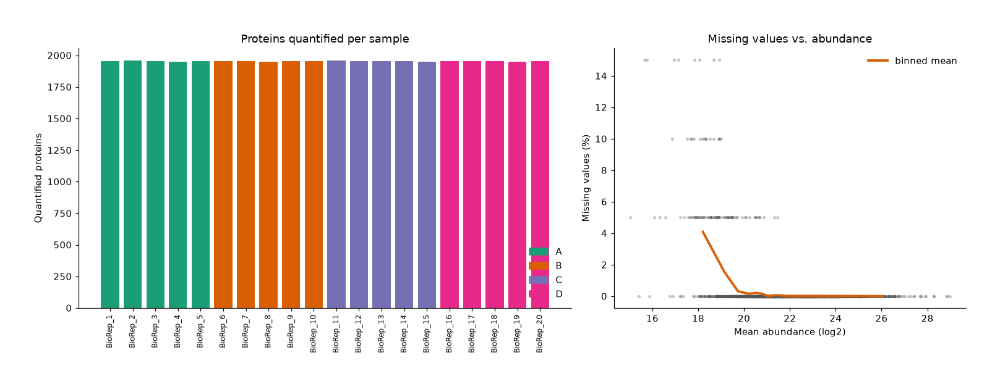

Precision - ``data.cv_plot()`` / ``data.cv_table()``
----------------------------------------------------

Coefficient of variation of each protein within each condition (linear scale). Label-free experiments
usually have median CVs of 10-20% between biological replicates; a condition with much higher CVs
points to a noisy sample or batch.

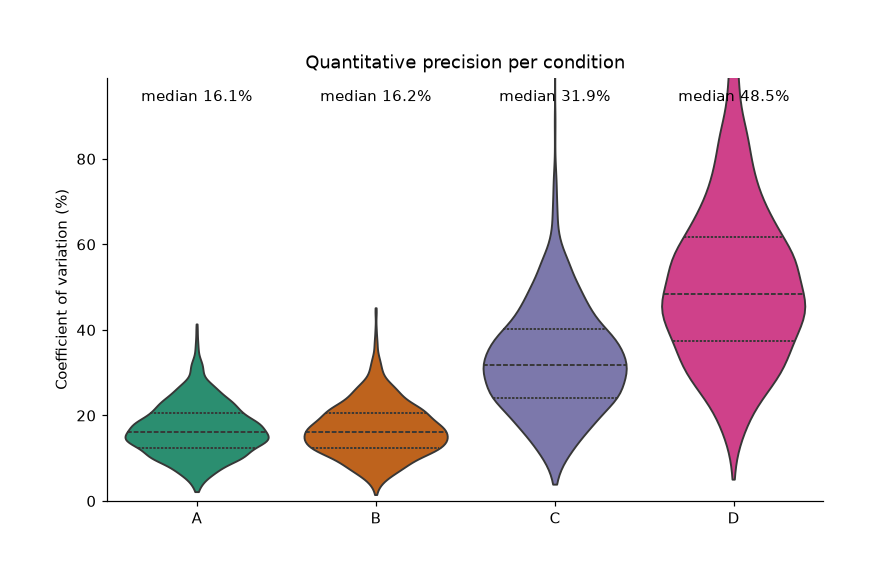

Sample outliers - ``data.outlier_plot()`` / ``data.sample_outliers()``
------------------------------------------------------------------------

Each sample is compared with the replicates of its own condition: robust distance from the condition
centre in PCA space, and median correlation with the other replicates. Samples beyond the cutoffs are
flagged in the ``outlier`` column. Differences between conditions in noise level are taken into account,
so a noisy condition is not flagged as a whole. In simulations an injected bad sample was always
flagged and no clean sample was.

To leave samples out, run the analysis again with ``exclude_samples``; the names shown in the results
(or the sample names of the input file) are accepted, and the statistics are always recomputed without
them (p-values imported from the input file are discarded):

.. code-block:: python

    flagged = data.sample_outliers().query('outlier')['Sample'].tolist()
    data = omics.OmicScope('static_4groups.xlsx', Method='General', exclude_samples=flagged)

Exclude a sample only when there is a reason, and only once: after removing samples the reference
changes and another sample may then look borderline. ``methods_text()`` and ``reproducible_script()``
record the exclusion.

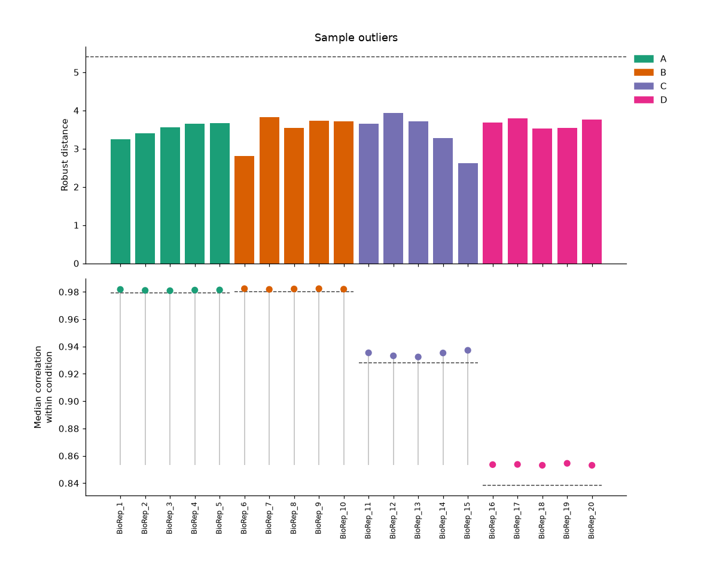

Batch effects - ``data.batch_plot()`` / ``data.batch_effect()``
-----------------------------------------------------------------

With a ``Batch`` column in pdata, the samples are shown on the first two principal components before and
after removing the batch terms. ``OmicScope(..., batch_correction=True)`` uses the corrected values in
the statistics (see :doc:`statistics`). In simulations with a strong batch effect, correction raised the
share of true changes found from about 70% to 99%, with an FDR of about 6% at a nominal 5%.

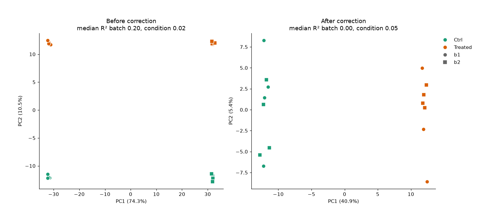

Differential abundance
======================

Effect sizes - ``data.effect_plot()`` / ``data.effect_table()``
-----------------------------------------------------------------

For two conditions, the difference of log2 means of each protein with its 95% confidence interval and
Hedges' g (columns ``Mean difference``, ``CI95 low``, ``CI95 high`` and ``Hedges' g`` of ``quant_data``).
Pass gene names to choose the proteins, or ``top=`` for the most significant ones. For more conditions,
``Eta squared`` gives the share of each protein's variance explained by the conditions.

.. code-block:: python

    data2 = omics.OmicScope('static_2groups_n3.xlsx', Method='General')
    data2.effect_plot(top=15)

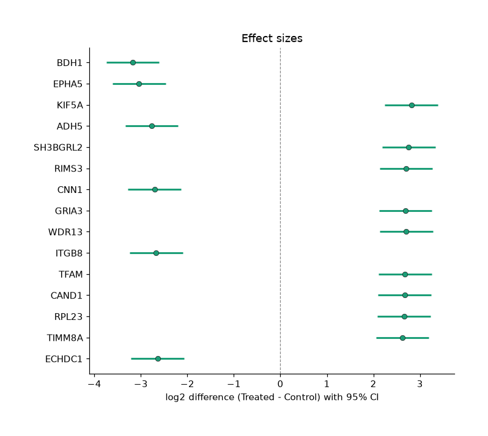

Expression patterns
===================

Protein co-expression map - ``data.protein_map()`` / ``data.protein_embedding()``
-----------------------------------------------------------------------------------

t-SNE (or ``method='pca'``) map of the protein profiles; proteins changing together across samples lie
close together, coloured by k-means cluster. In a t-SNE map only the grouping is meaningful, not the
distances between groups.

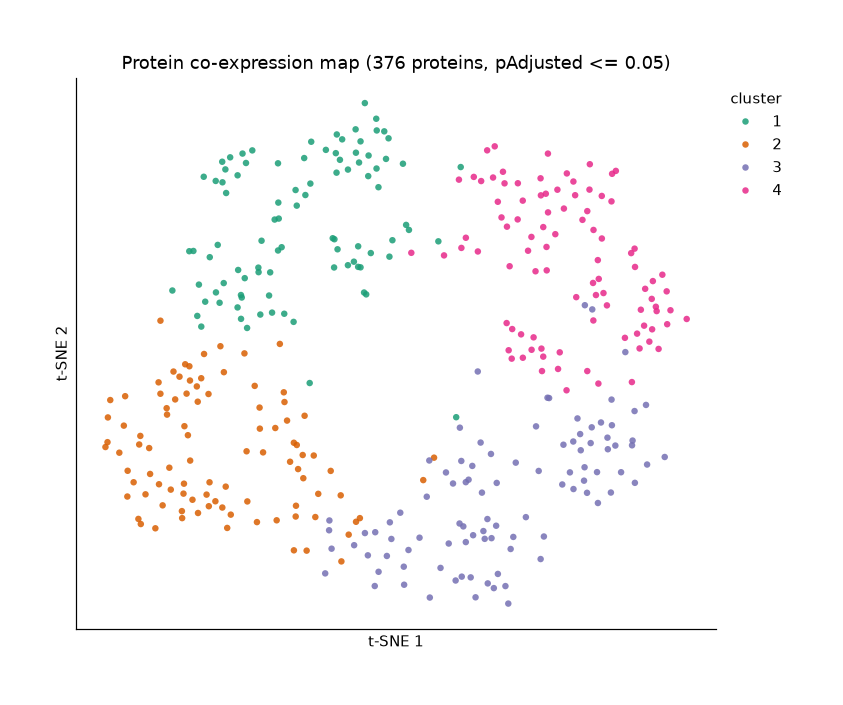

Co-expression modules - ``data.coexpression_modules()``, ``data.module_trait_plot()``, ``data.module_eigengene_plot()``
------------------------------------------------------------------------------------------------------------------------

A light version of WGCNA: signed correlation network, topological overlap, hierarchical clustering and
a tree cut into modules, each summarised by its eigengene. Modules that are no stronger than those
found in shuffled data are discarded, and proteins join a module only if they correlate with it more
than shuffled proteins do. The heatmap shows the correlation of each eigengene with each condition (and
with ``TimeCourse`` in longitudinal designs).

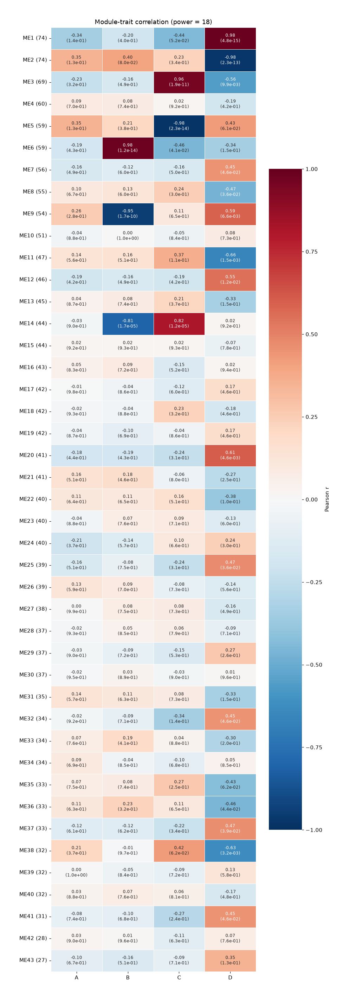

Classification and biomarkers
=============================

PLS-DA - ``data.plsda_plot()`` / ``data.plsda()``
-------------------------------------------------

PLS-DA always separates the groups on its score plot, even in pure noise. OmicScope therefore reports
the cross-validated accuracy and a permutation p-value (the full cross-validation rerun with shuffled
labels). Trust the separation only when both are convincing. With very few samples the permutation
p-value cannot get small: with three samples per group there are only 20 distinct ways to assign the
labels. VIP scores rank the proteins driving the separation.

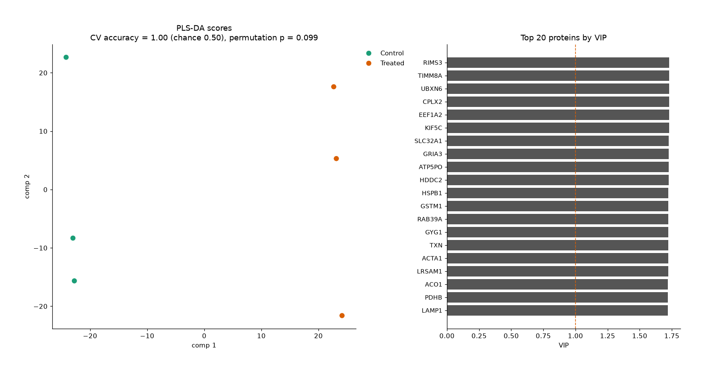

ROC curves and biomarker panels - ``data.roc_plot()``, ``data.roc_table()``, ``data.biomarker_panel()``
-----------------------------------------------------------------------------------------------------------

``roc_table`` gives the AUC of every protein with its 95% confidence interval. ``biomarker_panel``
evaluates a logistic-regression panel of ``n_features`` proteins by repeated cross-validation, choosing
the proteins inside each training fold. Its AUC is therefore an honest estimate for new samples: on data
with no real difference it stays near 0.5.

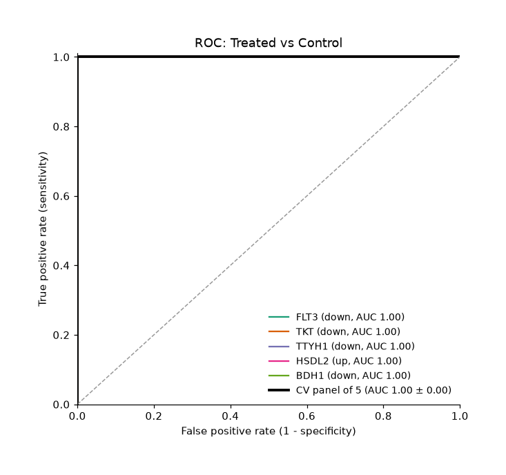

Study design
============

Power analysis - ``data.power_plot()`` / ``data.power_analysis()``
--------------------------------------------------------------------

Expected power of a two-group t-test per protein, averaged over the protein variances measured in
your data, for several fold changes and numbers of replicates. With ``fdr_share``, ``alpha`` is read as
an FDR level and converted to the matching per-test threshold. The analytical values agreed with
simulated t-tests within 2.5 percentage points.

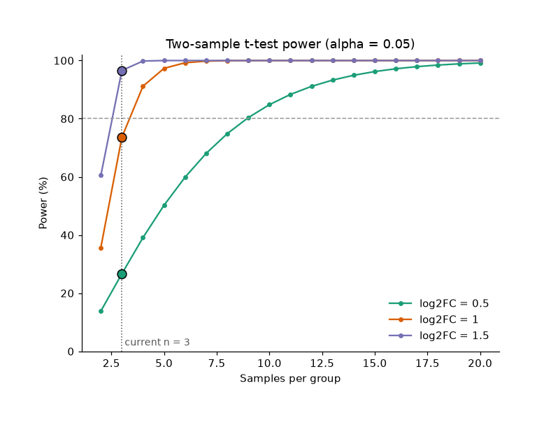

Reporting
=========

``data.methods_text(enrichment=None)`` writes a methods paragraph describing the analysis that was
actually run (including choices made automatically, such as Welch tests), with references.
``data.reproducible_script(table='file.xlsx')`` returns Python code that reruns the same analysis.

Enrichment
==========

.. code-block:: python

    enrichment = omics.EnrichmentScope(data, Analysis='GSEA', dbs=['KEGG_2021_Human'])

``enrichment.gsea_plot(term)``
    GSEA running enrichment score of one term.
``enrichment.term_foldchange(top=15)``
    Fold change of the proteins behind each top term: consistent up- or down-regulation, or a mix.
``enrichment.collapse_terms(similarity=0.5)``
    Groups terms that share most of their proteins and keeps the most significant one as representative.
``data.cluster_enrichment(clusters, dbs)`` and ``omics.cluster_dotplot(results)``
    Over-representation analysis of each protein cluster or co-expression module, compared on one dot plot.
Custom gene sets
    ``dbs`` accepts library names, a dictionary ``{term: [genes]}`` or the path of a ``.gmt`` file
    (``omics.read_gmt`` / ``omics.write_gmt``), for ORA and GSEA.

Several studies
===============

Meta-analysis - ``nebula.meta_plot()`` / ``nebula.meta_analysis()``
---------------------------------------------------------------------

Combines each protein's evidence across studies with Stouffer's method on signed z-scores. Proteins
changing the same way in several studies reach strong combined evidence; opposite changes cancel out.
Each study contributes at most \|z\| = 5, so one study with extreme p-values cannot carry the result alone.
``consistency`` is the share of studies agreeing with the combined direction.

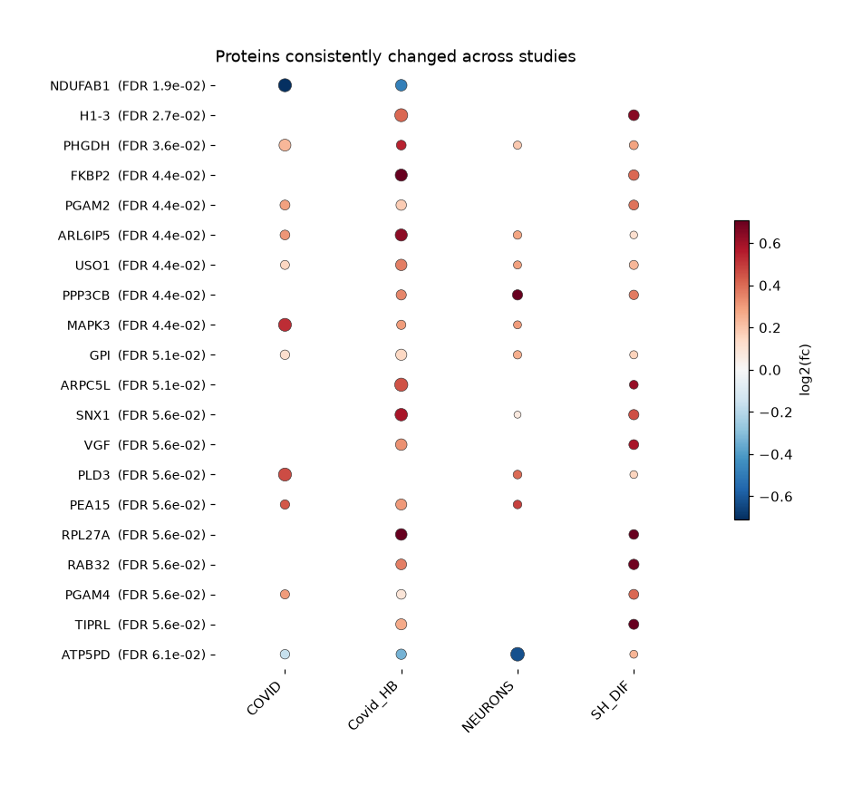
